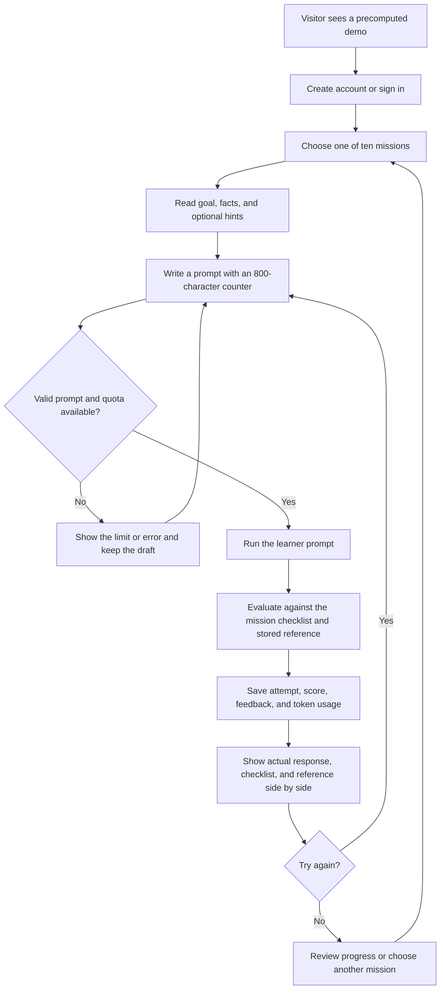

# Contexer

Contexer is an English-language game for learning prompt engineering by observing cause and effect. Learners write prompts for short missions, see the model's actual response, identify missing instructions, and compare their result with an independently executed reference prompt. Accounts, saved progress, evidence-based scoring, and an administrator usage dashboard are planned; the current code is an early Lovable prototype.

**Repository:** [Contexer on GitHub](https://github.com/IslamOuda85/Contexer-AI_Dev_Tools_Zoomcamp)

## 1. Problem and goal

A vague prompt can leave an AI model to guess the audience, facts, format, or constraints. Contexer makes those guesses visible and helps a learner improve one prompt at a time. The initial curriculum has ten curated missions. The product is free to learners; the project owner pays for AI calls and sets usage limits.

The [project plan](project_plan.md) defines behavior, scope, acceptance criteria, and delivery stages. The [backlog](backlog.md) tracks issue-sized work and its GitHub issue links when published.

## 2. Suggested ecosystem

| Concern | Suggested choice | Current status |
| --- | --- | --- |
| Web application | React, TypeScript, TanStack Start, Tailwind CSS | Already present in the prototype |
| Package manager | npm with a committed lockfile | Proposed standard; the prototype currently has `bun.lock` |
| Server | TanStack Start server functions and server routes | One Lovable AI server function exists; the final contract is pending |
| Identity and data | Supabase Auth and PostgreSQL with row-level access rules | Planned |
| AI service | OpenAI Responses API called only from the server | Planned; the prototype uses the Lovable AI gateway |
| Local services | Docker-based local application and database/auth stack | Planned and must be verified as a single-command run |
| Hosting | Vercel for the application, managed PostgreSQL/Auth, `contexer.owda.io` as a candidate domain | Planned, not deployed |
| Source and delivery | GitHub repository, Issues, Actions, development and production environments | Public repository created; Issues and workflows pending |
| Testing | Vitest for unit logic, Testing Library for UI, Playwright for browser flows, and a separate model-quality evaluation set | Planned |
| Observability | OpenTelemetry with correlated logs, traces, and metrics, collected in a Grafana-compatible stack | Planned |

The first setup task will confirm the npm choice, generate its lockfile, and retire the unused Bun lockfile so clean installs are reproducible. The selected hosting and Supabase integration must pass a small end-to-end spike before the architecture is treated as final.

## 3. Learner journey



The reference prompt is revealed after the first attempt. Its response is generated independently, reviewed, and stored when the mission is prepared. A normal learner attempt then uses two AI calls: one for the learner's response and one for evaluation and concise feedback. The score is computed from weighted, mission-specific checklist items; the initial pass rule is 80% with no critical item missing.

## 4. Current implementation

The prototype has a landing page, ten mission cards, a prompt editor, a response display, and a server function that asks the Lovable AI gateway for a reply, score, coaching, and an improved example in one call. Best scores live only in browser memory and disappear on refresh. The mission scenarios are drafted, but their rubrics and reference prompts still need review. Accounts, a database, automated tests, containerization, CI/CD, a verified public deployment, and operational monitoring are not yet included in this checkout.

This distinction matters when reviewing progress: the product plan and backlog describe intended behavior, while this section describes what the checked-in prototype currently does.

## 5. Run the current prototype locally

Prerequisites: Node.js and npm. From this directory:

```sh
npm install
npm run dev
```

The page can render without an AI key, but submitting a prompt currently requires a server-side `LOVABLE_API_KEY`. Do not commit real keys. This dependency will be replaced by the OpenAI integration in the backlog. The prototype has `npm run build` and `npm run lint`; it does not yet have a test command.

## 6. Project workflow

- [Project plan](project_plan.md): user journeys, scoring rules, milestones, and acceptance criteria.
- [Backlog](backlog.md): ordered tasks and GitHub issue mapping.
- [Agent instructions](AGENTS.md): durable project context and role boundaries.
- [Agent team](docs/agent-team.md): project-manager handoff and planned engineer/QA roles.
- [2026 final-project criteria](https://github.com/DataTalksClub/ai-dev-tools-zoomcamp/blob/main/project/README.md): authoritative rubric to recheck before submission.

The course requires a public project and three peer reviews. Issue, deployment, test, and monitoring links will be added here once they exist.

After creating and pushing the public GitHub repository, the owner can run `./scripts/publish-backlog.ps1` from PowerShell with GitHub CLI authenticated. The script creates or reuses issues whose titles contain the backlog IDs, then writes their verified URLs into `backlog.md`. Review the issue bodies and commit the updated backlog afterward.
