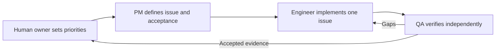

# Agent team and handoffs

The project uses focused roles to keep product decisions, implementation, and verification reviewable. The human owner decides product direction, budgets, deployment, and publication. Agents work from the public issue tracker and the acceptance criteria in [project_plan.md](../project_plan.md) and [backlog.md](../backlog.md).

## Project manager — active

The [project manager agent](../.codex/agents/project_manager.toml) refines the problem, prioritizes backlog tasks, records dependencies and open decisions, and writes acceptance checks. It distinguishes the current prototype from planned behavior. It does not implement application code or claim an issue exists until its URL is verified.

For a planning task, the PM returns: the proposed issue title and outcome, acceptance checks, dependencies, rubric mapping, questions that materially affect scope, and a short decision log. The owner or coordinating agent reviews these before work starts.

## Engineer — planned

The engineer will take one approved issue at a time, implement within its boundary, run relevant checks, and report changed files, evidence, and remaining risks. An engineer cannot silently change product acceptance criteria to make an implementation pass.

## QA reviewer — planned

The QA reviewer will independently compare behavior with the issue's acceptance checks. The reviewer reports reproducible gaps and evidence, including tests and observed UI behavior, without editing the implementation being reviewed. The issue returns to the engineer if a required check fails.

## Handoff loop

An issue or PR should identify the backlog ID, links to the public tracker item, relevant acceptance results, and any decision made during implementation. The PM updates the backlog when scope or dependencies change. The owner reviews external publication and operational changes.
