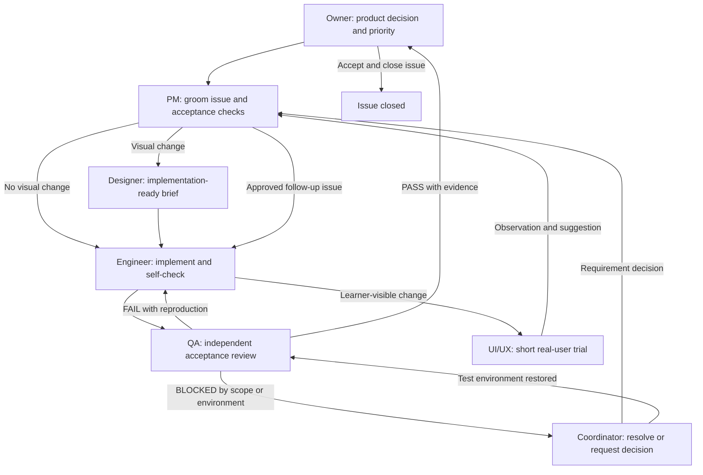

# Agent team and handoffs

Contexer uses focused roles so product decisions, implementation, design, and verification remain reviewable. The human owner decides product direction, budgets, deployment, and publication. The coordinating agent routes work and keeps the issue and handoff record together. The [project plan](../project_plan.md) defines intended behavior; the [backlog](../backlog.md) and linked GitHub issues define task boundaries. The [course graph-engineering article](https://aishippingblog.com/p/ai-native-development-specifications) describes the PM → engineer → independent QA loop that this workflow adapts.

## Roles and outputs

| Role | Responsibility | Output and recipient | Boundary |
| --- | --- | --- | --- |
| [Project manager](../.codex/agents/project_manager.toml) | Groom one issue, clarify scope, dependencies, acceptance checks, and decisions. | Issue-ready brief to the coordinator, designer when visual work is needed, and engineer. | Does not implement code or silently change owner decisions. |
| [Designer](../.codex/agents/designer.toml) | Define intentional blue/dark-blue visual language, typography, component styling, responsive and accessible states. | Implementation-ready design brief to engineer; scope questions to PM/owner. | Does not judge QA acceptance or claim user testing. |
| [Software engineer](../.codex/agents/software_engineer.toml) | Implement the groomed issue and run relevant checks; review reproducibility, scalability, security, integrity, modularity, and product relevance. | Changed files, commands/results, and remaining risks to QA and coordinator; UI build to learner-trial agent when relevant. | Does not lower acceptance criteria or sign off its own work. |
| [QA engineer](../.codex/agents/qa_engineer.toml) | Independently judge the running result and changes against each acceptance check, including data security, service integrity, functionality, and failure resilience. | `QA: PASS`, `QA: FAIL`, or `QA: BLOCKED` with evidence to coordinator; failures to engineer for correction. | Does not fix reviewed code or claim absolute guarantees. |
| [UI/UX learner-trial agent](../ui-ux-engineer.md) | Act as a first-time learner and observe clarity, motivation, colors, layout, and prompt-improvement journey. | Separate [trial report](ui-ux-trial-01.md) to PM/owner; confirmed usability gaps can become new issues. | Experience feedback is not QA acceptance or a design brief. |

## Routing graph

The coordinator selects the next open, unblocked issue from [backlog.md](../backlog.md) whose dependencies are complete, giving priority to the Pass phase before Showcase and Advanced work. If several issues are eligible, it chooses the smallest reviewable one and records the choice; the owner may change the priority. It verifies the issue URL and acceptance checks before assignment. If the issue cannot be reached or a dependency is unclear, it asks the PM to resolve the blocker. The coordinator assigns one issue at a time and shares its ID, URL, acceptance checks, relevant files, and previous handoff. Agents communicate through issue comments or an English Markdown handoff in `docs/`; a message in chat can point to that record. A direct message to another agent must include the same issue ID and evidence link. The coordinator resolves routing and records who receives the next action; no role assumes that an unacknowledged message changed scope. Parallel designer and engineer work may use separate branches or worktrees, but only one agent owns a file at a time.

## Handoff contract and stop rules

Each handoff records: **issue ID/URL; sender → recipient; outcome sought; acceptance checks affected; changed files or design decisions; checks run with observed results; verified findings versus assumptions; blockers and risks; next action.** Link the report or issue comment from the next role's task. Never put secrets, real learner prompts, or customer data in handoffs. The PM maintains the decision log and backlog when an acceptance check changes.

1. PM sends a groomed issue to the coordinator. When a screen or component changes, the designer sends a brief before the engineer implements it. The owner resolves product direction that remains ambiguous.
2. The engineer implements a bounded issue, runs relevant checks, and sends evidence to QA. Tests written by the engineer are evidence, not independent sign-off.
3. QA tests each acceptance check and records `PASS`, `FAIL`, or `BLOCKED`. A `FAIL` includes steps, expected and actual behavior, impact, and the failed check; it returns to the engineer. The engineer fixes it and requests a fresh QA review. A `BLOCKED` goes to the coordinator with the missing requirement or test environment; it is never treated as a pass.
4. For learner-visible changes, the UI/UX agent performs a separate short trial. The PM turns meaningful observations into proposed follow-up issues; an observation does not silently expand the current issue.
5. The coordinator presents QA evidence, remaining risks, and any learner-trial feedback to the owner. The issue may be closed only when required checks pass and the owner has reviewed the result. When a check is untestable or a high-impact risk remains, keep it open or record an explicit owner decision with its scope.

This graph is a documented human-guided workflow, not an autonomous deployment or issue-closing service. An agent's `PASS` certifies only the checks actually performed in the named environment. The [first UI/UX trial](ui-ux-trial-01.md) is a blocked handoff, not evidence of usability. The [initial engineering review](engineering-review-01.md) records code findings that later issues must address.
