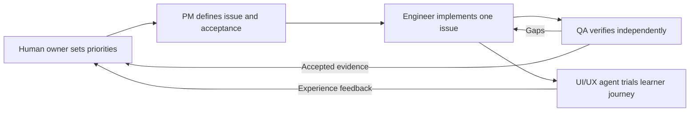

# Agent team and handoffs

The project uses focused roles to keep product decisions, implementation, and verification reviewable. The human owner decides product direction, budgets, deployment, and publication. Agents work from the public GitHub issue tracker and the acceptance criteria in [project_plan.md](../project_plan.md) and [backlog.md](../backlog.md).

## Project manager — active

The [project manager agent](../.codex/agents/project_manager.toml) refines the problem, prioritizes backlog tasks, records dependencies and open decisions, and writes acceptance checks. It distinguishes the current prototype from planned behavior. It does not implement application code or claim an issue exists until its URL is verified.

For a planning task, the PM returns: the proposed issue title and outcome, acceptance checks, dependencies, rubric mapping, questions that materially affect scope, and a short decision log. The owner or coordinating agent reviews these before work starts.

## Software engineer — active

The [software engineer agent](../.codex/agents/software_engineer.toml) takes one approved issue at a time, implements within its boundary, runs relevant checks, and reports changed files, evidence, and remaining risks. It also reviews each implementation stage for reproducibility, scalability, security, integrity, modularity, and relevance to the product requirements. An engineer cannot silently change product acceptance criteria to make an implementation pass. The [initial code audit](engineering-review-01.md) records findings that later issues must address.

## QA reviewer — planned

The QA reviewer will independently compare behavior with the issue's acceptance checks. The reviewer reports reproducible gaps and evidence, including tests and observed UI behavior, without editing the implementation being reviewed. The issue returns to the engineer if a required check fails.

## UI/UX learner-trial agent — active

The [UI/UX agent](../ui-ux-engineer.md) acts as a new learner using the actual app on desktop and a narrow screen. It tries account creation when available, submits a weak prompt, improves it after feedback when possible, and reports color, layout, clarity, and motivation in a separate trial report. Its [agent definition](../.codex/agents/ui_ux_engineer.toml) keeps the role distinct from engineering and formal QA. Observations can inform new issues but are not acceptance sign-off.

## Handoff loop

An issue or PR should identify the backlog ID, link to the tracker item, report changed files and relevant acceptance results, and record any decision made during implementation. If an acceptance check is not met, keep the issue open and state the missing evidence. The PM updates the backlog when scope or dependencies change. The owner reviews external publication and operational changes.
