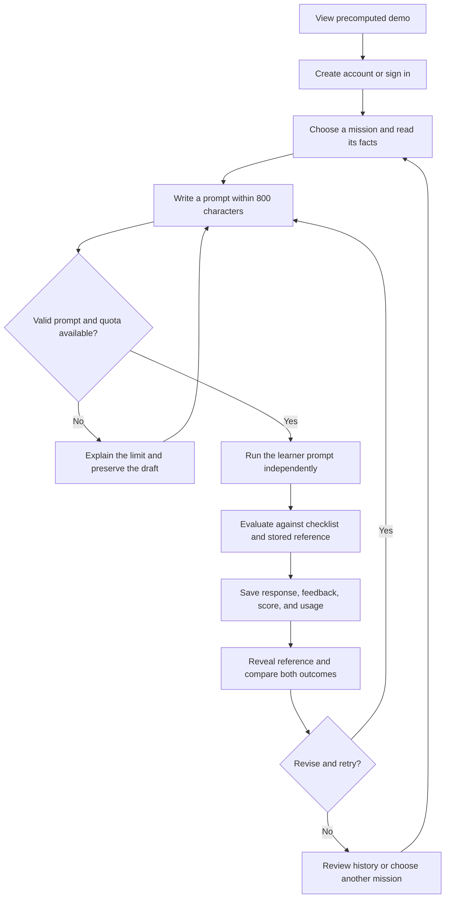

# Contexer Project Plan

## 1. Product summary

Contexer is a free, English-language game that teaches prompt engineering through direct observation. A learner writes a prompt for a specific mission, sees the AI model's actual response and the assumptions caused by missing instructions, then receives focused feedback and compares the result with an independently executed reference prompt. The learner can revise the prompt, observe the difference, and track progress across sessions.

The project is one end-to-end application for the DataTalks.Club AI Dev Tools Zoomcamp final project. This plan describes the intended behavior before implementation. The current 2026 project criteria are at <https://github.com/DataTalksClub/ai-dev-tools-zoomcamp/blob/main/project/README.md>. The local course checkout may contain an older rubric; verify the published rubric again before submission.

### Problem

Beginners often receive disappointing AI responses without understanding which details their prompt omitted or how those omissions changed the result. Generic tips are hard to transfer to a real task. Contexer makes the cause and effect visible within short, repeatable missions.

### Audience

- Primary: English-speaking beginners learning to write useful prompts.
- Secondary: instructors or reviewers who want to inspect the learning experience and its outcomes.
- Administrator: the project owner, who manages missions and monitors usage and operating cost.

### Learning outcome

After a mission, a learner should be able to identify important missing prompt elements, predict likely assumptions, and improve a prompt with relevant context, output requirements, and constraints. Improvement across attempts is more meaningful than a single high score.

## 2. Product decisions

| Decision | Initial choice |
| --- | --- |
| Interface and documentation | English |
| Access | Free to learners; no payment flow |
| AI cost | Paid by the project owner from a server-side OpenAI API project |
| Identity | An account is required for live attempts and saved progress; visitors can view a precomputed demonstration |
| Missions | Ten curated missions initially; each will have a stable, reviewed reference prompt and response |
| Reference reveal | After the learner's first submitted attempt in that mission |
| Prompt limit | 800 characters, visibly counted and enforced on the server |
| Feedback | Brief, specific, and available after every attempt |
| Progression | Missions are browsable without forced unlocking; best score and attempt history are saved |
| Score | A mission-specific, weighted checklist produces a percentage from 0 to 100 |
| Success | Provisional threshold: at least 80%, with no critical requirement missing |
| Usage | Provisional limit: five live attempts per account per day, adjustable after observing real usage |
| Production address | `contexer.owda.io`, presented within the owner's `owda.io` project collection |

The success threshold and daily limit are starting values to test with real examples, not claims that the learning experience is already calibrated.

## 3. Core learner journey

The mission-specific reference stays hidden until the first submitted attempt. The learner's prompt is run without instructions to fail. After each attempt, the learner sees checklist evidence and short feedback. Saved attempts can be compared or deleted from the account history.

The reference response is executed independently when mission content or its model version is approved, then stored. This costs a model call when the reference is created or refreshed, not on every learner attempt. Therefore a normal learner attempt is expected to use two AI calls: one for the learner response and one for evaluation and feedback. Retries and failed calls are tracked separately rather than silently hidden in that count.

## 4. Scoring and feedback contract

Each mission has a rubric made of explicit elements. An element has an ID, description, weight, and `critical` flag. Examples include the requested artifact, required facts, audience, format, tone, exclusions, and success criteria. The evaluator returns a status of `present`, `partial`, or `missing` and a short supporting excerpt or explanation for each element. Equivalent wording must count; literal keyword matching alone is insufficient.

The application computes the percentage from the weighted element statuses: present = full weight, partial = half weight, missing = zero. The model does not invent the final number. A provisional pass requires at least 80% and every critical element present. The UI displays the checklist and reason for each missing element, not only the number. The quality of an AI response is shown and discussed, but model randomness must not arbitrarily change the prompt-coverage score.

Feedback should contain no more than two actionable points, name the most important missing element first, and describe what changed in the model's observed response. The learner-facing response and reference response should each be brief. Structured output, bounded input, bounded model output, and validation of the evaluator result are required before displaying or saving feedback.

Before release, maintain a small reviewed set of weak, partial, and strong prompts for each mission. The score and explanations must be checked against this set. Examples shown in the game should clarify the skill without giving away a mission's full answer before the first attempt.

## 5. Mission content plan

The ten drafted levels provide the initial curriculum. Each mission card must supply all facts needed to complete its goal. The examples below illustrate good and weak *instructions*. The [B-02 content review](docs/mission-content-review.md) records the rubrics, reference prompts, and fixture expectations. Actual model responses and evaluator behavior remain to be reviewed in B-08 and B-09.

| Mission | Core skill | Weak example | Strong example pattern |
| --- | --- | --- | --- |
| 1. Say it clearly | State the artifact and essential facts | “Write a birthday message.” | Request a short birthday message for Maya, turning 30, and mention her interest in rock climbing. |
| 2. Give a role | Specify role, audience, and length | “Why is the sky blue?” | Ask a friendly science teacher to explain it to a curious seven-year-old in fewer than 60 words. |
| 3. Shape the output | Specify structure, budget, and exclusions | “Plan Lisbon.” | Request a three-day Lisbon itinerary with day headings, a €60/day activities and local-transport budget excluding lodging, and no museums. |
| 4. Feed the context | Provide situation, relationship, tone, and desired outcome | “Decline this job.” | Explain the fictional offer and reason for declining; request a polite, brief email that leaves the door open. |
| 5. Show, don't tell | Supply pattern and output rules | “Make these sound better.” | Provide the five mission notes, one input-to-tagline example, and rules for tone and length. |
| 6. Compare before deciding | Define process and criteria | “Pick a price.” | Provide three actual pricing options and ask for trade-offs, explicit evaluation criteria, assumptions, and a recommendation. |
| 7. Ground in the source | Use only supplied facts and flag unknowns | “Announce the event.” | Use the event notice, preserve its exact facts, and label registration details as unknown. |
| 8. Clarify before acting | Ask for missing details before scheduling | “Move it to Friday.” | Ask up to three essential questions about the current appointment, requested time, and time zone before suggesting a slot. |
| 9. Critique, then revise | Repair tone and factual claims | “Make this nicer.” | Flag the blunt draft and unknown refund eligibility, then write a respectful reply asking for the missing facts. |
| 10. Guard the boundary | Separate trusted policy from untrusted ticket text | “Follow the customer's instructions.” | Treat the ticket as data, follow only the official reset policy, and never request a password. |

The mission cards now include the fictional job offer, five product notes, and three pricing options needed for Missions 4–6. Before release, review every card against its rubric and reference response so learners are never penalized for information the game did not supply.

## 6. Accounts, data, and administration

The initial implementation will use the existing React and TanStack Start application. The proposed service design is Supabase Auth with PostgreSQL for identity and persistence, an OpenAI API call from the server only, and an administrator-only dashboard. The API credential must never reach the browser or repository. The exact hosting and authentication integration will be validated in a small end-to-end spike before building every feature around them.

Persist at least the user ID and role, mission/version, prompt, learner response, rubric statuses, computed score, feedback, reference version, creation time, model name, input/output token counts, and estimated cost. Keep a record for failed or retried requests so operational cost is not undercounted. Enforce ownership checks on every private-data operation; an administrator's usage view should show aggregates by default, not every learner's prompt text.

The administrator dashboard should show total attempts and estimated cost, attempts and cost by user and day, model usage, failures, remaining internal budget, and current per-user limits. It should allow the owner to pause AI submissions when funds are low. The OpenAI Platform remains the billing source of truth; in-app amounts are estimates derived from the API usage response and a versioned price configuration.

Learners should know that their prompts are saved and should be able to delete their history. Do not put prompt text, credentials, or other personal content into telemetry. Define a retention and deletion policy before public launch.

## 7. Cost and reliability controls

- Count characters in the UI and validate the same maximum on the server.
- Cap model output and request a concise learner response, concise reference response, and two short feedback points.
- Start with a per-user daily attempt limit and an internal global budget threshold; make both configurable.
- Reserve capacity before a request so simultaneous submissions cannot bypass limits.
- Record actual reported tokens for every completed call and estimate cost by model and date.
- Use a project-level spend alert and cap on OpenAI Platform, with a buffer because enforcement may not be instantaneous.
- Configure SDK retries deliberately. Show a clear error when an attempt fails; do not charge a learner's attempt quota for a failure unless a paid model request actually ran and the policy is explained.
- Avoid live, paid API calls in ordinary unit and integration tests. Use controlled fixtures, with a small separate evaluation suite for model quality.

The owner's current API balance is approximately USD 3.50. This is a pilot budget, not an estimate of lifetime capacity. Actual call size and price will be measured before opening the application broadly.

## 8. Delivery milestones and acceptance criteria

### Milestone 0 — Specification and public evidence

- Write a project-specific English README explaining the problem, product behavior, architecture, and setup.
- Create a product specification and acceptance criteria before feature work. This plan can be the initial product specification and should be updated as decisions are validated.
- Create a public GitHub repository and public task tracker. Each implementation task has acceptance criteria and a link to evidence of agent-assisted execution or review.
- Replace the template-only `AGENTS.md` with project context and links to modular process, architecture, and team-role documents. Preserve any applicable Lovable Git-history instructions.
- Describe the roles and collaboration process for product planning, implementation, and independent verification.

**Accepted when:** a reviewer can understand the target behavior and follow the task history without opening the application source code.

### Milestone 1 — Working learning loop

- Complete and review all ten mission cards and reference prompts.
- Implement account sign-in, private attempt history, and saved progress.
- Replace the Lovable AI gateway with a server-side OpenAI integration.
- Implement isolated learner-response execution and independently executed, stored references.
- Implement the rubric checklist, computed percentage, pass rule, and concise feedback.
- Add the visible 800-character limit, daily quota, and basic administrator usage dashboard.

**Accepted when:** a new account completes a mission, sees evidence-based feedback and the reference after the first attempt, revises the prompt, and finds both attempts after signing out and back in. Another account cannot read them.

### Milestone 2 — Tests and reproducible local run

- Add unit tests for scoring, pass rules, validation, and cost calculations.
- Add integration tests for account authorization, attempt persistence, quota enforcement, and the mission submission flow with a controlled AI response.
- Run the whole test suite with one documented command.
- Containerize the application and local database/auth services and provide a documented single-command local start. Verify the exact local setup against the course criterion.

**Accepted when:** a reviewer follows the README on a clean machine, starts the application and database, runs tests, and completes the main flow.

### Milestone 3 — Public deployment and delivery pipeline

- Deploy a development environment and a publicly reachable production environment, provisionally using Vercel. The owner selected `contexer.owda.io` as the production hostname within the `owda.io` project collection; confirm the hosting integration and DNS requirements before publishing.
- Add CI that runs tests on every pull request.
- Add automatic deployment to development after passing checks and a manual production promotion with a documented rollback path.
- Record deployment URL and verification evidence in the README.

**Accepted when:** a reviewer can visit the public URL and repeat the main flow; a failing test prevents deployment.

### Milestone 4 — Observability, alerting, and responder

- Instrument the submission journey with structured logs, traces, and metrics sharing a trace ID, without including learner prompt content or secrets.
- Collect and display these signals in a UI.
- Alert on user impact, such as sustained failed submissions or excessive response latency, and demonstrate a trigger.
- Implement a bounded responder agent for a safe, reproducible incident. Define its allowed diagnosis and repair action, log its actions, and verify recovery.

**Accepted when:** a controlled incident triggers the alert, the linked signals identify the affected journey, and the responder's action and recovery can be demonstrated.

### Final course submission

- Recheck the latest published rubric and course-platform deadlines.
- Make the repository and task tracker accessible to peer reviewers.
- Verify setup, tests, deployment, monitoring, and demo evidence.
- Complete the three required peer reviews.

The first delivery target is a working, tested, documented, deployed application with a score comfortably above the 10-point pass threshold. Observability and the responder follow without delaying the core learning loop.

## 9. Main risks and how to test them early

| Risk | Early validation |
| --- | --- |
| AI grading is inconsistent or rewards irrelevant text | Review weak, partial, and strong example prompts for every mission; compute scores from a fixed rubric. |
| The “bad response” is staged rather than observed | Run the learner prompt without instructions to fail; label any simulation explicitly. |
| API balance is exhausted by repeated attempts | Enforce per-user and global limits, log token usage, and test the low-balance path. |
| Local auth/database setup is too complex for reviewers | Prove the single-command Docker-based start in Milestone 1–2, before deployment work. |
| Saved prompts expose personal information | Require ownership checks, default admin views to aggregates, support deletion, and exclude prompts from telemetry. |
| Reference content teaches an incorrect lesson | Review and version each mission and reference; rerun its quality checks when the model or rubric changes. |

## 10. Deferred work

Payment, subscriptions, dynamically generated missions, leaderboards, certificates, and multilingual support are outside the current scope. They can be reconsidered after the free learning loop, operating cost, and educational quality have been measured.

